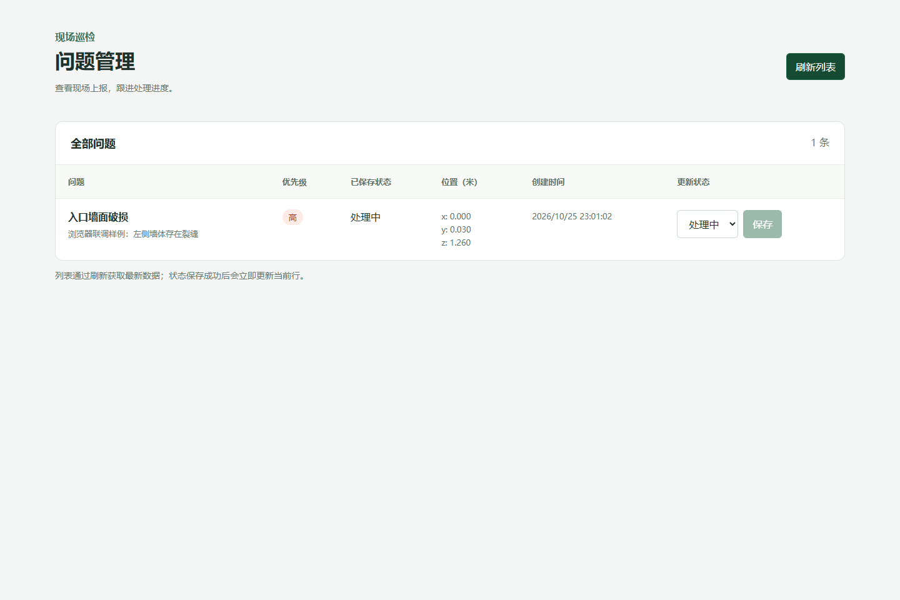

# 验证记录

初次验证日期：2026-10-25；Unity 构建与手机部署追加日期：2026-10-26。

## 已通过

| 项目 | 方法 | 结果 |
| --- | --- | --- |
| Go 参数校验 | go test -v ./... | 空白标题、非法优先级、缺少坐标、null 坐标、缺少位置、错误 JSON、null 请求体、多个 JSON 均返回 400，含明确错误 |
| 状态与 ID | Go 测试 | 非法状态返回 400，不存在 ID 返回 404，生成 ID 不同 |
| 空列表 | Go 测试和浏览器 | 返回 items 空数组，页面显示暂无问题 |
| 状态生命周期 | Go 测试 | 创建默认 open，状态可切换，创建时间保留 |
| 数据库持久化 | 关闭并重新打开真实 SQLite 文件 | 问题及修改后的状态保留 |
| CORS | 预检请求测试和浏览器跨来源请求 | 指定来源允许 PATCH，未配置来源的预检被拒绝 |
| Go 检查与构建 | go vet ./...；go build | 通过 |
| TypeScript 与生产构建 | npm run build | 通过 |
| 前端依赖审计 | npm audit --audit-level=moderate | 0 项漏洞 |
| React 与 Go 联通 | Playwright、Edge、独立 Go 进程 | 创建问题后刷新可见，状态保存成功，API 中数据同步变化 |
| 保存失败处理 | 浏览器拦截状态接口返回 500 | 显示错误，已保存状态不变，待提交选择保留，可重试成功 |
| 后端中断 | 真实停止 Go 进程 | 刷新显示连接错误，已有列表保留 |
| 进程重启持久化 | 重新启动 Go 并使用同一数据库 | 刷新后仍能读取问题及处理中状态 |
| 首次加载断网 | 后端关闭时重新加载页面 | 页面标题和明确错误可见，没有白屏 |
| 浏览器运行错误 | 监听 pageerror | 0 条 |

浏览器联调使用脚本创建的测试数据模拟移动端 POST，不代表 Unity 真机上报已通过。测试数据库在 .tools 内，与实际演示数据库隔离。

## 检查后修正

1. 首次安装后，npm audit 指出初选 Vite 7.1.12 存在已知问题。升级到 7.3.7，重新构建和审计，0 项漏洞。
2. 检查数据库路径时，发现从源码推导默认目录会让分发后的二进制依赖构建机路径。改用稳定的系统用户配置目录；启动脚本显式指定项目内数据库绝对路径，避免重启切换目录造成误判。
3. 检查 Unity 构建逻辑时，发现仅使用 Shader.Find 可能导致运行时 Shader 被剥离，增加显式保留。实际构建又发现 Standard 光照材质会编译数万个变体，随后将标记改用内置 Unlit/Color，显式保留 Unlit/Color 和 Sprites/Default，并移除不需要的灯光；修正后通过 APK 构建。
4. 检查移动端触摸逻辑时，采用触摸开始时的显式 UI RaycastAll，避免依赖 EventSystem 更新顺序。真实设备上的 UI 拦截仍需验证。

## 2026-10-26 构建与部署追加

| 项目 | 结果 |
| --- | --- |
| Unity 环境 | 已安装官方国际版 Hub 3.15.2、Unity 6000.0.62f1 及 Android Build Support |
| 安装包来源与完整性 | 编辑器与 Android Support 使用官方来源、官方 MD5 校验并验证签名；ARCore 服务包与 Google 官方 SHA-256 一致 |
| Android 工具链 | OpenJDK 17.0.9、NDK r27c、SDK 36、Gradle 8.13；已完成 SDK 许可证配置 |
| Unity 包解析与 C# | 实际解析通过，生成 packages-lock.json，编辑器和 Player 脚本编译通过 |
| 中文目录问题 | 第一次构建明确报 Invalid project path；建立 D:/Unity/InspectionProject 目录联接后通过，源码仍位于原目录 |
| Android 原生构建 | IL2CPP ARM64 与 Gradle 构建通过 |
| APK | unity/Builds/inspection.apk，29,064,060 字节 |
| 包信息 | com.inspection.prototype，版本 1.0 / versionCode 1，minSdk 24，targetSdk 36，arm64-v8a |
| APK 签名 | apksigner verify 通过 |
| APK SHA-256 | ae8ccef45d2f71b95b5ed6a1dcaecb334a0300cab6c662ca282a462672301078 |
| 手机后端连通 | 手机通过局域网请求电脑 /api/health，返回 HTTP 200 和 status ok |
| ARCore 服务 | 用户手动安装后，通过包管理查询确认版本 1.57.262640093 |
| 项目 APK 传输 | 已复制到手机 Download/AR_Inspection_1.0.apk，手机端 SHA-256 与电脑一致 |
| 项目 App 安装 | ADB 被手机返回 INSTALL_FAILED_USER_RESTRICTED；用户手动安装后，包管理查询确认 com.inspection.prototype 1.0 已安装 |
| App 启动 | am start -W 返回 Status ok，主进程存在；手机解锁后确认 App 在前台，相机权限 granted=true |
| 运行时 ARCore | 日志确认初始化及配置，启用 RearCamera、PositionAndRotation、PlaneDetection、AutoFocus、Raycast；未发现 E/Unity、FATAL EXCEPTION 或所检索的脚本异常 |

构建脚本增加了英文项目路径参数、等待编辑器主进程退出、敏感日志过滤，以及手机拒绝 ADB 时复制到下载目录的明确提示。没有把“构建成功”或“文件复制成功”当作“手机已安装”的证据。

## 仍待验证

已通过 Unity 官方包注册表确认 AR Foundation 6.0.8、ARCore 6.0.8、Core Utils 2.4.0、Legacy Input Helpers 2.1.11 存在，并下载相应包源码核对了所用的关键 XR 设置、平面与 Origin API。所有自有 Assets 文件和目录均有 .meta，入口场景的脚本 GUID 引用一致。

初次验证时本机没有 Unity 和连接的 AR 手机；2026-10-26 已补齐环境并实际完成上述编译、构建及网络验证。注册表和源码检查已由实际 Unity 构建补充验证。

仍待验证项目包括：真实平面边界显示、标记位置、UI 触摸拦截、中文输入显示、软键盘行为、手机表单实际提交与成功/失败提示。

两段演示视频和外部分享链接待实际验收后准备，不能使用管理端联调截图替代真机证据。

## 2026-10-26 提交超时排查

- 用户报告点击 Submit 无法成功。
- 手机 App 进程日志记录 Curl error 28，15001 毫秒连接超时；后端健康接口正常，问题列表为空。
- 在 App 前台检查其界面，Backend URL 为 http://192.168.1.100:8080；电脑实际 WLAN 地址为 192.168.10.101。
- 从同一手机请求 http://192.168.10.101:8080/api/health，返回 HTTP 200 和 status ok，确认正确地址的手机到后端网络正常。
- 根因为手机仍使用预填演示 IP。手机拒绝 ADB 输入注入，未擅自改变系统安全设置；已请用户在界面改为正确地址并重试。
- 源码取消首次启动时预填演示 IP，改为空地址并提示必须配置。该源码调整尚未重新打包；现有 APK 手动改地址即可继续使用，不需要为配置改动重新安装。
- 后续手机表单提交结果待核对，不将健康接口成功当作问题创建成功。

## 2026-10-26 墙面支持 1.1

- 已启用水平和竖直平面检测，并改用命中表面法线放置立方体。
- Unity 实际构建通过，APK 签名验证通过；包名 com.inspection.prototype，versionName 1.1、versionCode 2，arm64-v8a。
- 当前 unity/Builds/inspection.apk 已更新为 1.1，大小为 29,064,000 字节，SHA-256 为 28514035aff8879a60ce7bdeb4a83e21af5a72605183b4556708271de5ebd7bb；上方 1.0 的大小和哈希为历史记录。
- 当前 ADB 未检测到手机，未安装或声称墙面实测通过。需覆盖安装后验证水平面仍可放置、墙面可识别及标记沿表面法线贴合。

## 2026-10-26 1.1 手机覆盖安装

- 用户重新连接手机后，ADB install -r 返回 Success；包管理查询确认 versionName 1.1、versionCode 2，原相机权限保留为 granted=true。
- 启动命令返回 Status ok，应用进程存在；日志可见 ARCore 初始化入口，所检索日志未发现 Unity 脚本异常。手机后来未停留在巡检 App 前台，未将启动命令成功当作墙面实测通过。
- 电脑 WLAN 地址已由 192.168.10.101 变为 192.168.10.102。前后端服务正常，手机访问新地址的 /api/health 返回 HTTP 200 和 status ok；App Backend URL 需同步使用新地址。
- 原有应用数据通过覆盖安装保留；仍需在 App 前台扫描有纹理的墙面，验证竖直边界、贴墙方向与上报流程。

## 2026-10-26 稳定放置 1.2.1

- Unity 编译和实际 APK 构建通过，构建前 11 项 PlacementStability 检查通过；覆盖小幅抖动、移动瞄准、平面切换、法线变化、样本不足、样本过期、完整窗口、同帧大幅跳变、无效数值、竖直姿态和重置。
- 首轮 1.2 真机日志发现圆柱预览的 CapsuleCollider 被裁剪，改用扁平立方体光标；重新构建、签名验证和覆盖安装 1.2.1 成功。
- 最终包 versionName 1.2.1 / versionCode 4，大小 29,092,808 字节，SHA-256 为 8ba7f64d28569a4368654f5c803f8205150a02be763770ab983612a30c02b42c。
- 手机包管理确认新版本和相机权限，启动成功，ARCore PlaneFindingMode 为 3；检查新进程日志未发现 E/Unity、FATAL EXCEPTION、NullReferenceException、UnityException 或 Anchor creation failed。
- 用户实际确认“光标变绿并成功放置”，作为稳定预览和确认放置的真机交互验证。
- 前后端健康检查正常，电脑地址为 192.168.10.102。应用沿用原保存地址，仍应核对 Backend URL，不能将锚定放置成功当作表单上报已通过。
- 本次未量化定位误差或漂移改善，未全面验证所有表面、失去跟踪恢复、重复替换、后台切换及 UI 误触场景；未接入 Depth。
